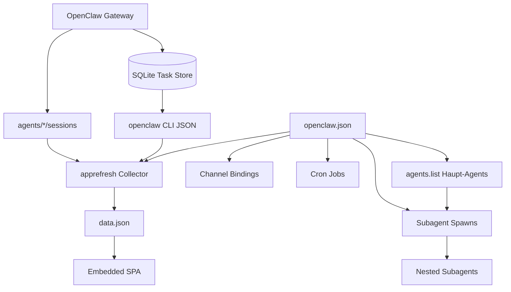

# Multiagent- & Subagent-System (OpenClaw Dashboard)

> **Generiert am**: 2026-10-04  
> **Projekt**: mammouth-dashboard / OpenClaw Dashboard  
> **Rolle des Dashboards**: Read-only Observability — **nicht** der Spawn-Orchestrator  
> **Plan-ID**: Warp-Plan „Multiagent- & Subagent-System OpenClaw Dashboard“

---

## 1. Executive Summary

OpenClaw betreibt ein **Multiagent-System**: mehrere Agents (`agents.list[]`), Channel-Bindings, Cron-Jobs und **Subagents** mit konfigurierbarer Spawn-Tiefe. Das Dashboard sammelt, normalisiert und visualisiert diesen Zustand in einer zero-dependency Go-Binary mit embedded SPA.

Nach **OpenClaw 2026.6** liegen Cron- und Subagent-Läufe im gemeinsamen **SQLite Task Store** der Gateway. Das Dashboard liest sie über CLI (`openclaw tasks list --json --runtime subagent` / `openclaw cron list --json`), weil zero-dep **keinen SQLite-Treiber** einbindet.

---

## 2. Domänenmodell



### 2.1 Haupt-Agents

| Quelle | Felder | UI |
| :--- | :--- | :--- |
| `agents.list[]` | `id`, `role`, `model` (string \| `{primary,fallbacks}`), `workspace`, `default` | Agent Cards, Agent Details Table, Model Routing |
| `agents.defaults` | Default-Model, Compaction, `subagents.*` Limits | Runtime Config, Subagent Limits |
| `bindings[]` | `agentId` + match (`channel`, `peer`, `accountId`, `guildId`, `teamId`) | Agent Bindings Panel |

Parser: `internal/apprefresh/refresh_config.go` → `parseAgents`, `parseBindings`, `parseOpenclawConfig`.

### 2.2 Subagents

| Aspekt | Spezifikation |
| :--- | :--- |
| **Spawn** | Durch OpenClaw Gateway / Parent-Agent (außerhalb Dashboard) |
| **Limits** | `defaults.subagents.maxConcurrent`, `maxSpawnDepth`, `maxChildrenPerAgent` → `agentConfig.subagentConfig` |
| **Runs (2026.6+)** | `openclaw tasks list --json --runtime subagent` |
| **Mapping** | `internal/apprefresh/subagent_tasks.go` → `subagentRuns*` |
| **Felder pro Run** | `task` (≤80 runes), `agent`, `status`, `durationSec`, `timestamp`, `date`, `error` |
| **Kosten/Tokens** | Nicht im Task Store exponiert → UI ausgeblendet / Compatibility-Felder = 0 |

Status-Werte (Task Store): `succeeded`, `failed`, `running`, `queued`, `cancelled`, `timed_out`, `lost`.

### 2.3 Hierarchie (Session-basiert)

| Feld | Bedeutung |
| :--- | :--- |
| `sessions[].type` | `cron` \| `subagent` \| `group` \| `telegram` \| `main` \| `other` |
| `sessions[].spawnedBy` | Parent-Session-Key |
| `sessions[].active` | `updatedAt` jünger als 30 Min |

UI: `Renderer.renderAgentTree` in `web/index.html`:

- Roots = Sessions mit `type !== 'subagent'`
- Children = Subagents gruppiert nach `spawnedBy`
- Grandchildren = eine weitere Ebene
- „Recent finished“-Fenster hält gerade beendete Nodes kurz sichtbar

**Gap:** Durable Tasks haben (Stand jetzt) **keine** Parent-Kette → Activity-Panel und Tree können divergieren.

### 2.4 Runtime Health (Queue)

`/api/system` → `openclaw.status.tasks` aus `openclaw status --json`:

- `total`, `active`, `terminal`, `failures`
- `byStatus{queued,running,succeeded,failed,…}`
- `byRuntime{subagent,acp,cli,cron}`

---

## 3. Datenfluss Collector

```text
collectDashboardData
  ├─ parallel: gateway lock/health, crons (CLI→legacy file), git log
  ├─ parse openclaw.json → agentConfig (+ subagentConfig, agents, bindings)
  ├─ loadSessionStores → collectSessions (type, spawnedBy, model chain)
  ├─ readyzProbe → channel health backfill
  ├─ CollectTokenUsageWithCache (JSONL; subagent run list empty post-2026.6)
  ├─ collectSubagentRuns (CLI tasks --runtime subagent)
  │    ├─ FilterByDate → Today / 7d / 30d
  │    └─ LimitSlice → 20/30/50/100
  └─ assemble data.json
```

Timeout CLI Subagent-Collect: **10s**. Fehler → leere Liste (kein Legacy-Session-Key-Fallback).

---

## 4. Frontend-Panels (Multiagent-relevant)

1. **Active Sessions + Agent Hierarchy Tree** — live Parent/Child
2. **Sub-Agent Activity** — tabbed Runs (Today/7d/30d/all)
3. **Sub-Agent Token Usage** — historisch/JSONL; nach Migration oft leer/0
4. **Charts** — `dailyChart[].subagentRuns` / `subagentCost` (Cost oft 0)
5. **Agent & Model Configuration** — Cards, Routing, Limits, Bindings, Runtime Health
6. **Cron Jobs** — automation owned by agent IDs

---

## 5. Constraints (nicht verhandelbar ohne explizite Entscheidung)

- Zero third-party Go dependencies (`go.mod` ohne `require`)
- Kein direkter SQLite-Zugriff
- Loopback-only HTTP (außer opt-in Env)
- SPA via `//go:embed` → Frontend-Änderungen brauchen Rebuild
- Additive `data.json`-Felder; Breaking Changes vermeiden
- TDD + `make check` (vet, lint, race, govulncheck)

---

## 6. Lücken & priorisierte Roadmap

### P0 — Korrektheit & Transparenz

- [ ] Subagent-Status-Aggregation (running/queued/failed) sichtbar anbinden
- [ ] UI-Unterscheidung: „keine Runs“ vs. „CLI/Gateway unreachable“
- [ ] Parent-Felder vorbereiten (`parentTaskId` / `spawnedBy`), sobald CLI sie liefert

### P1 — Observability

- [ ] Filter/Search im Activity-Panel (Agent, Status, Text)
- [ ] Tree-Rekursion bis `maxSpawnDepth` + Collapse/Expand
- [ ] Optionale JSONL-Token-Schätzung klar als *estimated* markieren

### P2 — Steuerung (opt-in, später)

- [ ] Read-only Default beibehalten
- [ ] Optional loopback+token Actions (`tasks cancel`, …) inkl. Security-Review
- [ ] Export Subagent-Runs (JSON/CSV)

### P3 — DX

- [ ] Diese Spec aktuell halten
- [ ] Fixtures: nested spawn, empty CLI, partial hierarchy, offline gateway

---

## 7. Test-Anker

| Bereich | Dateien |
| :--- | :--- |
| Task parsing | `internal/apprefresh/subagent_tasks_test.go` |
| Integration CLI | `internal/apprefresh/subagent_integration_test.go` |
| Fixture JSON | `internal/apprefresh/testdata/cron/subagent-tasks.cli.json` |
| Sessions/spawnedBy | `internal/apprefresh/refresh_sessions_test.go` |
| Web contracts | `web_contract_test.go` |

---

## 8. Abgrenzung

| Das Dashboard **tut** | Das Dashboard **tut nicht** |
| :--- | :--- |
| Agents, Limits, Runs, Hierarchy **anzeigen** | Subagents **spawnen** |
| Gateway/Task-Queue **proben** | OpenClaw-Config **schreiben** |
| Kosten/Sessions **aggregieren** | SQLite der Gateway **öffnen** |

---

## 9. Referenzpfade

- Collector: `internal/apprefresh/subagent_tasks.go`, `refresh.go`, `refresh_config.go`, `refresh_sessions.go`
- UI: `web/index.html` (`renderAgentTree`, Sub-Agent tables, `subagentConfigPanel`)
- Docs: `ARCHITECTURE.md`, `TECHNICAL.md` (§ Sub-Agent Activity), `README.md` (Screenshots 04/06/08)
- Changelog: `CHANGELOG.md` v2026.6.15 (SQLite-migration compatibility)
